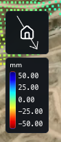
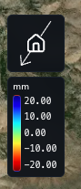
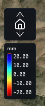
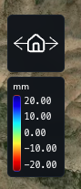

# Read the analysis legend

The map legend has two parts: a direction symbol above the color bar identifies the viewing geometry or deformation component, and the color bar shows how the selected field's values map to colors.

## Line of sight analyses

Ascending and descending analyses show deformation along the satellite's line of sight. Their legends use diagonal viewing-direction symbols. Sentinel-1 is right-looking, and the symbol distinguishes the viewing geometry of the two orbit directions.

| Legend | Analysis | Meaning |
| --- | --- | --- |
|  | **Ascending LOS** | The diagonal arrow runs from the upper left toward the lower right. This symbol identifies the ascending viewing geometry and corresponds to an **A** analysis. |
|  | **Descending LOS** | The diagonal arrow runs from the upper right toward the lower left. This symbol identifies the descending viewing geometry and corresponds to a **D** analysis. |

LOS deformation measures movement along that viewing direction. It can contain horizontal and vertical contributions; use an east–west–vertical analysis to examine the separate components.

## East west and vertical components

An **EWZ** analysis combines ascending and descending observations to resolve east–west and vertical deformation. The symbol changes with the component displayed.

| Legend | Component | Meaning |
| --- | --- | --- |
|  | **Vertical** | The vertical arrow identifies the up–down component of deformation. |
|  | **East–west** | The horizontal arrow identifies the east–west component of deformation. |

**East–west sign convention:** Negative values represent **westward** movement; positive values represent **eastward** movement.

## Read the color bar

Read each color against its numeric value and the units printed above the bar. In these examples, **mm** means millimeters of deformation. The direction symbol identifies the viewing geometry or component; use the numeric scale to interpret the colored data.

The scale depends on the selected field and **Colorscale Range**. Changing the colormap or **Invert** changes the relationship between colors and values, so check the legend after making adjustments. See [Change the map appearance](map-display.md) for these controls.

--8<-- "snippets/contact-footer.md"
