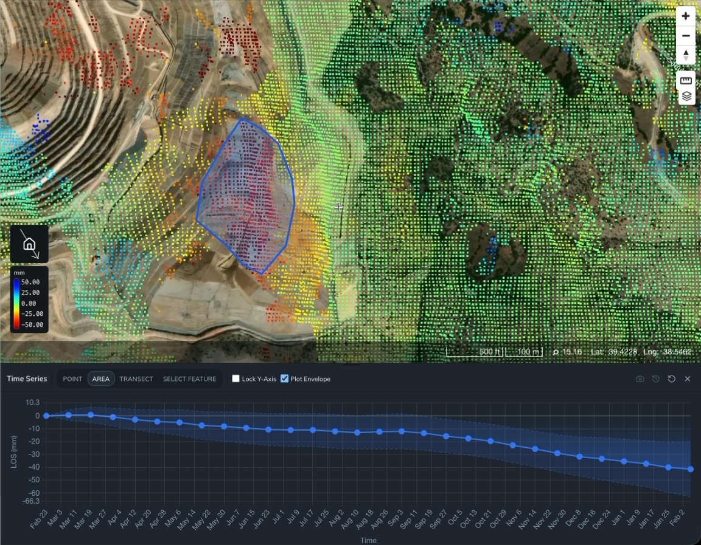
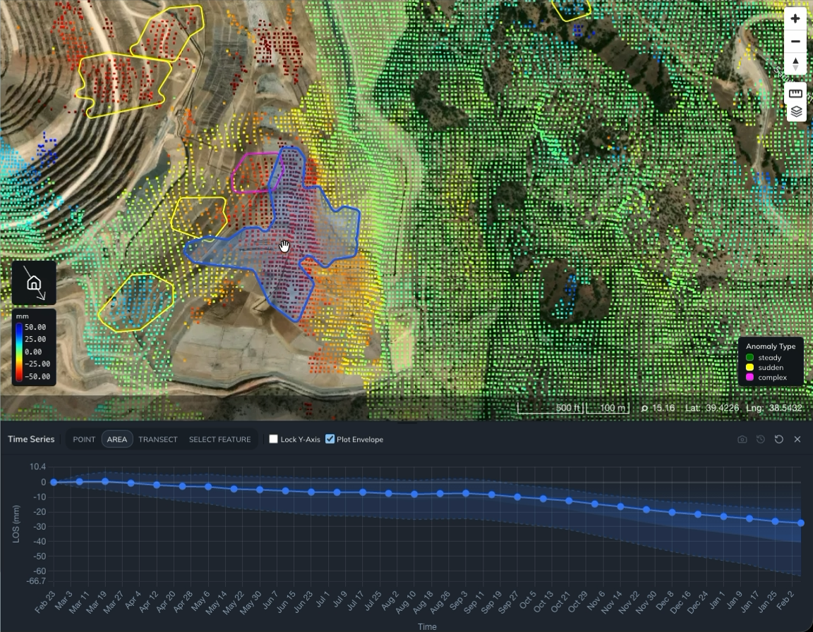

# View average deformation within an area

Draw a polygon or select an existing polygon on the map to view the average deformation within its boundary over time.

## Draw an area

1. [Open a site and analysis](select-site.md) and wait for the data to load.
2. In the **Time Series** toolbar beneath the map, click **AREA**.
3. Draw and complete a polygon around the area you want to investigate.
4. Wait for the area time series to load beneath the map.

Iris highlights the polygon and plots the average deformation of the data points inside it. The horizontal axis shows time; the vertical axis shows deformation. Check the axis label for the measurement and units.

## Select an existing polygon

Use **SELECT FEATURE** to inspect an area that already has a polygon on the map. For example, you can select an automatically calculated [deformation anomaly](deformation-anomalies.md).

You can also [draw or import polygon vector layers](vector-layers.md) to define your own boundaries.

1. Make the polygon layer visible. For anomaly polygons, turn on **Current Anomalies** in the **Anomalies** panel.
2. Click **SELECT FEATURE** in the **Time Series** toolbar.
3. Click the polygon you want to inspect on the map.
4. Wait for the area time series to update.

Iris highlights the selected polygon and shows the average deformation within its boundary. To inspect a different area, click **SELECT FEATURE** again and select another polygon.

--8<-- "snippets/contact-footer.md"
