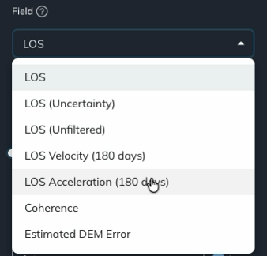
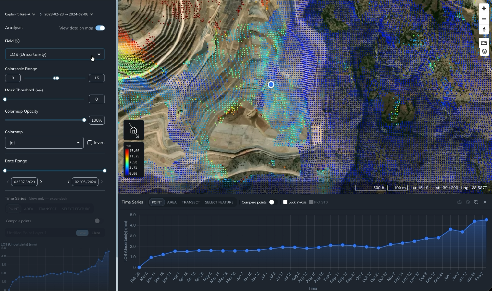
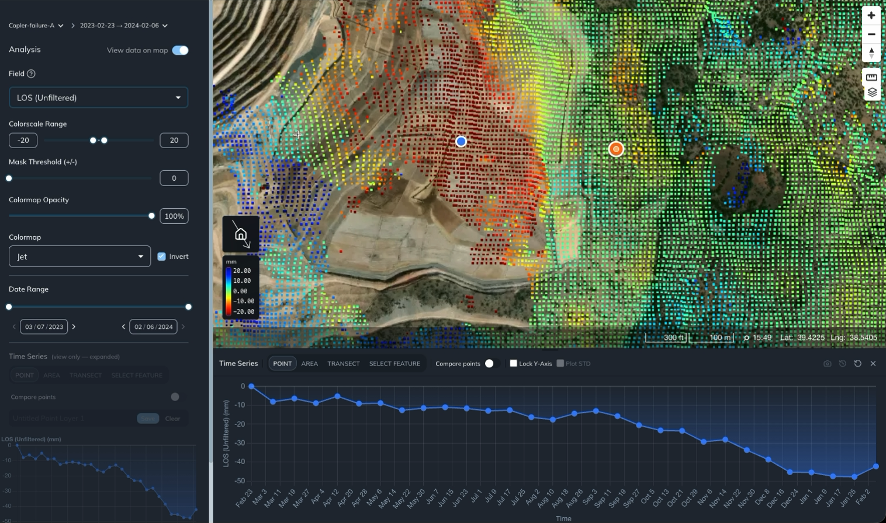

# Choose a deformation field

Use the **Field** dropdown to choose the measurement displayed on the map. For ascending and descending analyses, you can view line-of-sight deformation, examine its uncertainty, or measure movement relative to a reference point you choose.

## Select a field

1. [Open a site and analysis](select-site.md) and wait for the data to load.
2. Open **Field** in the **Analysis** panel on the left.
3. Select the field you want to view and allow the display to update.

Check the map legend and chart axis labels after switching fields, because the quantity being displayed changes.

The [direction symbol above the color bar](analysis-legends.md) identifies the LOS viewing geometry or the east–west or vertical component of an EWZ analysis.

## LOS

**LOS** means **line of sight**: deformation measured along the satellite's viewing direction.

The **LOS** field uses spatial filtering to highlight local deformation. At each epoch, Iris fits a broad spatial trend to the data and subtracts it. The resulting deformation is relative to the surrounding deformation rather than to a single reference point you select.

Spatial filtering can also remove broad deformation signals. To investigate movement relative to a known location, use **LOS (Unfiltered)**. See [Spatial Filtering in Iris](https://mining.earthdaily.com/knowledge-base/knowledge/spatial-filtering-in-iris) for the processing explanation.

To focus the map on deformation of interest, [set the color range](map-display.md#set-the-color-range) and [hide smaller movements with a mask threshold](map-display.md#hide-smaller-movements).

## LOS Uncertainty

Select **LOS (Uncertainty)** to display the estimated error associated with each point. Use this field to assess the deformation relative to its uncertainty.

In **POINT** mode, select a map location to inspect how its uncertainty changes through the analysis period. The vertical axis identifies the chart as **LOS (Uncertainty) (mm)**.

You can also show uncertainty as error bars on a deformation chart using [Plot STD](point-time-series.md#show-measurement-uncertainty).

## LOS Unfiltered

Select **LOS (Unfiltered)** to use an **orange reference marker** as the spatial reference for the data. Spatial filtering is not applied in this field. All displayed deformation is relative to the orange marker's location.

1. Choose **LOS (Unfiltered)** from **Field**.
2. Drag the orange marker to your reference location, such as a station known to have remained stable over the analysis period.
3. Use **POINT** mode to select the location you want to inspect. Its time series shows movement relative to the orange reference point.
4. Move the orange marker to change the reference location. Allow the map and chart to update.

The **blue marker** identifies the point you are inspecting; the **orange marker** sets the reference. Choose a reference near the area of interest with reliable data and known stability over the analysis window.

This field is useful for comparing movement with a stable station or examining the difference between adjacent moving and stable areas. The reference point's own movement affects all values measured relative to it. See [Spatial Filtering in Iris](https://mining.earthdaily.com/knowledge-base/knowledge/spatial-filtering-in-iris) for more guidance on reference selection.

## Additional fields

The **Field** dropdown also provides the following options when available for the analysis:

- **LOS Velocity (180 days)**
- **LOS Acceleration (180 days)**
- **Coherence**
- **Estimated DEM Error**

For background on velocity, acceleration, and coherence, see [Data Layers in Iris](https://mining.earthdaily.com/knowledge-base/knowledge/data-layers-in-iris).

--8<-- "snippets/contact-footer.md"
