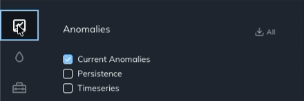
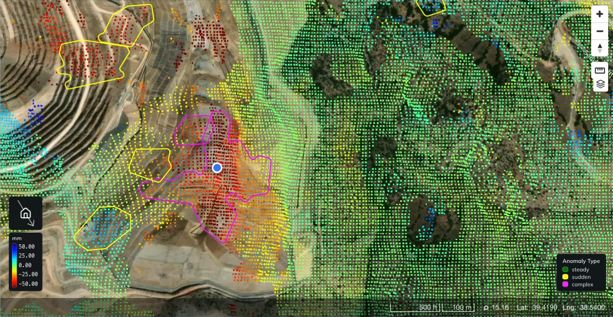

# Investigate deformation anomalies

Iris automatically identifies anomalous deformation and outlines the affected regions as polygons. Use these outlines to locate areas for closer inspection and view their average deformation over time.

## Show current anomalies

1. [Open a site and analysis](select-site.md) and wait for the data to load.
2. Click the **diamond-shaped exclamation icon** in the left toolbar to open **Anomalies**.
3. Select **Current Anomalies** to display the anomaly polygons for the latest acquisition in the analysis.

Use the **Anomaly Type** legend on the map to identify the categories. Clear **Current Anomalies** to hide the outlines.

## Understand anomaly types

| Type | Map color | Meaning |
| --- | --- | --- |
| **Steady** | Green | A linear deformation trend during the preceding 120 days, with velocity exceeding 0.05 mm/day. |
| **Sudden** | Yellow | A statistically anomalous rise in velocity during the most recent four acquisitions. |
| **Complex** | Magenta | Steady and sudden deformation behavior occurring within one contiguous area. |

These categories identify rapid or unusual deformation and changes from historical trends. They do not predict future motion or establish the overall stability of an area. See the existing [Deformation anomalies documentation](https://docs.earthdaily.com/mining/iris/using-iris/adding-anomalies/) for these definitions and [Anomaly Detection in Iris](https://mining.earthdaily.com/knowledge-base/knowledge/anomaly-detection) for methodology.

## Inspect an anomaly polygon

1. With the anomaly outlines visible, click **SELECT FEATURE** in the **Time Series** toolbar beneath the map.
2. Click an anomaly polygon.
3. Wait for its area time series to load.

The selected polygon is highlighted, and the chart shows average deformation within its boundary over time. See [View average deformation within an area](area-time-series.md) for the full area workflow.

To use the anomaly boundaries in other software, [export the polygons as GeoJSON](export-data.md#export-anomaly-polygons).

--8<-- "snippets/contact-footer.md"
