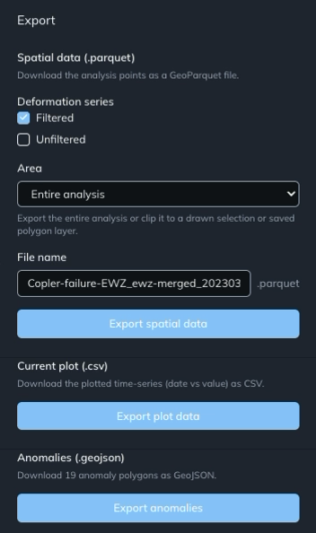
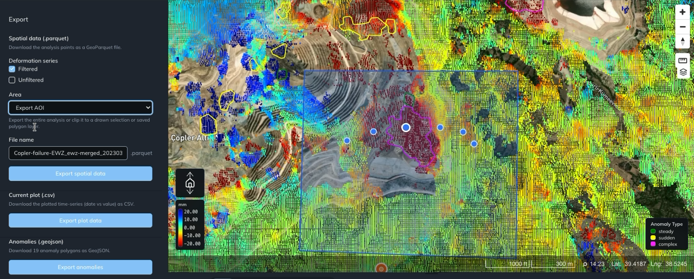

# Export analysis data and results

Use the **Export** panel to download analysis points, the data in the current plot, or deformation anomaly polygons.

| Export | Format | Contents |
| --- | --- | --- |
| **Spatial data** | GeoParquet (`.parquet`) | Filtered or unfiltered analysis data for the full analysis or a polygon AOI. |
| **Current plot** | CSV (`.csv`) | Data from the plot currently displayed in Iris. |
| **Anomalies** | GeoJSON (`.geojson`) | Deformation anomaly polygons for the analysis. |

## Open the Export panel

1. [Open a site and analysis](select-site.md).
2. Click the **download arrow icon** in the left toolbar to open **Export**.

## Export spatial data

1. Under **Spatial data (.parquet)**, choose the **Deformation series** to include: **Filtered**, **Unfiltered**, or both.
2. Open **Area** and select **Entire analysis** to export the full analysis, or choose a polygon layer to restrict the export to an AOI.
3. Enter your preferred name in **File name**. The output uses the `.parquet` extension shown beside the field.
4. Click **Export spatial data**.
5. Wait for Iris to prepare the export and complete the download.

The download contains analysis points in **GeoParquet** format. Open it in GIS software with GeoParquet support. See the [GeoParquet software list](https://geoparquet.org/#software) for compatible tools.

For background on spatial filtering, see [Choose a deformation field](data-fields.md).

## Export a polygon AOI

To export a specific area, first [draw or import a polygon layer](vector-layers.md). In the example below, the polygon layer is named **Export AOI**.

1. In **Export → Spatial data (.parquet)**, select the deformation series you want.
2. Set **Area** to **Export AOI**, or the name of your polygon layer.
3. Enter a file name and click **Export spatial data**.

Iris clips the spatial export to the selected polygon area.

## Export the current plot

1. Display the plot you want to download, such as a [point time series](point-time-series.md), [area average](area-time-series.md), or [transect profile](transect-profiles.md).
2. Open **Export**.
3. Under **Current plot (.csv)**, click **Export plot data**.

Iris downloads the data from the current plot as a CSV file.

## Export anomaly polygons

1. Open **Export** for the analysis you want.
2. Under **Anomalies (.geojson)**, check the displayed polygon count.
3. Click **Export anomalies** to download the anomaly vectors as GeoJSON.

See [Investigate deformation anomalies](deformation-anomalies.md) for the steady, sudden, and complex categories.

--8<-- "snippets/contact-footer.md"
