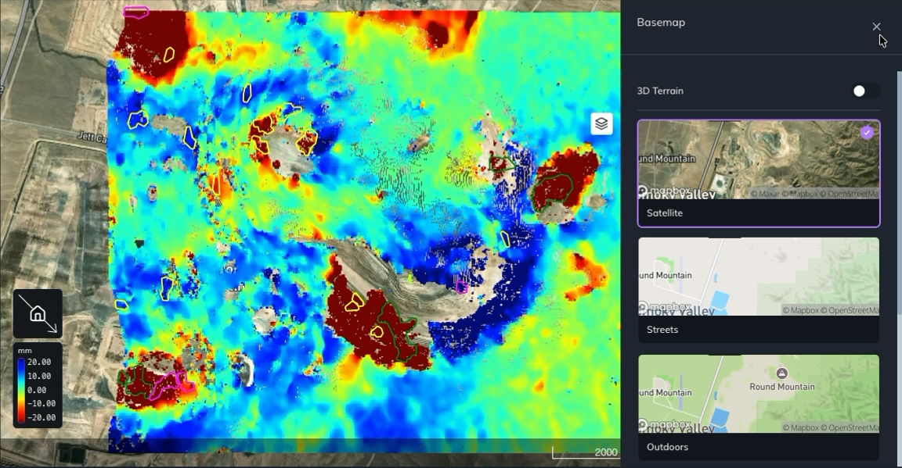
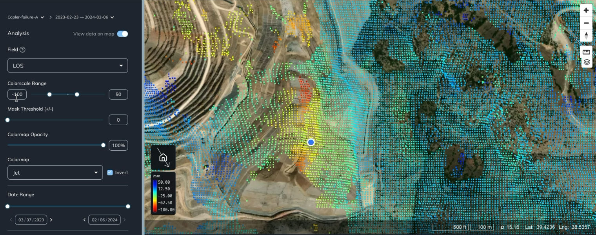
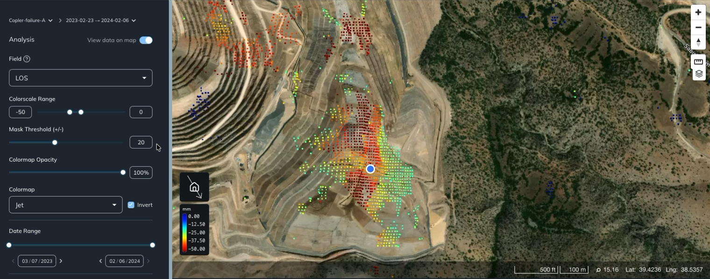
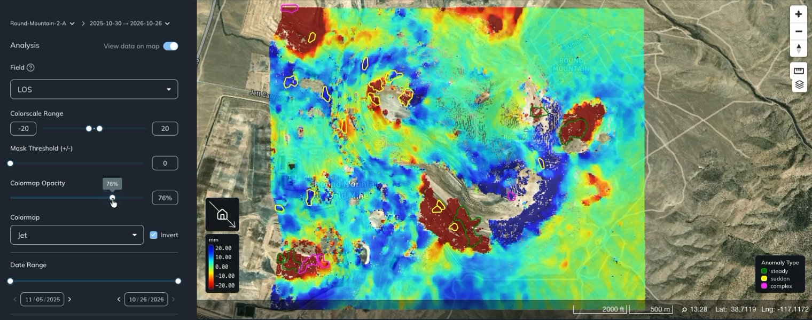
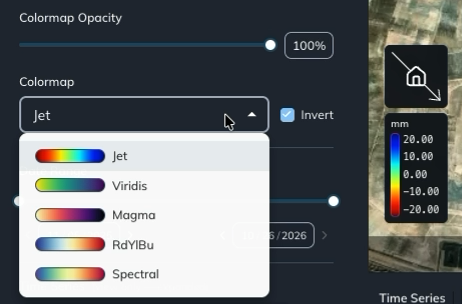

# Change the map appearance

Choose a basemap, set the color range, and hide smaller movements to focus on deformation of interest. Adjust the layer's opacity and palette to view the data alongside features on the ground.

## Open an analysis

[Select a site and analysis](select-site.md), then wait for the data to finish loading. Iris displays the analysis on the map, with **Analysis** controls on the left.

Use **Field** to [choose the deformation measurement](data-fields.md) before adjusting its appearance.

Read the [analysis legend](analysis-legends.md) to identify the viewing geometry or deformation component and interpret the color bar.

## Change the basemap

The basemap provides geographic context beneath the deformation data.

1. Click the **stacked layers icon** on the right side of the map to open the **Basemap** panel.
2. Click a basemap thumbnail to apply it. Options include **Satellite**, **Streets**, and **Outdoors**. Scroll within the panel to see more options.
3. Click **×** in the panel's upper-right corner to close it.

Use **Satellite** to see imagery of the site, or try **Streets** or **Outdoors** for a map background.

## Set the color range

Use **Colorscale Range** in the **Analysis** panel to set the minimum and maximum values represented by the color bar.

1. Enter a minimum in the left value box and a maximum in the right value box, or drag the two slider handles.
2. Allow the map to update.
3. Check the color legend on the map to see the new value-to-color mapping.

For **LOS**, the values are in millimeters. You can set a symmetric range around zero or use different limits on either side. In the example below, the minimum is **−100 mm** and the maximum is **50 mm**.

Changing this range changes the colors used to display deformation. Use **Mask Threshold (+/-)** to hide points with smaller movement magnitudes.

## Hide smaller movements

Use **Mask Threshold (+/-)** to hide points whose deformation magnitude is below an absolute threshold. The threshold applies to both positive and negative values.

1. Find **Mask Threshold (+/-)** below **Colorscale Range**.
2. Enter a threshold in the value box, or adjust the slider.
3. Allow the map to update to show the points that pass the threshold.

For example, set the threshold to **20** when viewing **LOS** to focus on movement greater than **20 mm** in magnitude. Points with **−30 mm** or **30 mm** of deformation remain visible, while points with **−10 mm** or **10 mm** are hidden.

Set the threshold back to **0** to show smaller movements again.

## Adjust the data opacity

Use **Colormap Opacity** in the **Analysis** panel to control how strongly the deformation layer covers the basemap.

1. Find the **Colormap Opacity** slider on the left.
2. Drag it left to make the data more transparent, or right to make it more opaque. The percentage beside the slider shows the current setting.

Lower the opacity when you want to see roads, terrain, or other features beneath the data. Increase it when you want the data colors to stand out. At **100%**, the data layer is fully opaque where data is displayed.

## Change the colormap

The colormap assigns colors to the values shown on the map.

1. Open the **Colormap** dropdown in the **Analysis** panel.
2. Select a palette, such as **Jet**, **Viridis**, **Magma**, **RdYlBu**, or **Spectral**.
3. To reverse the order of the colors, toggle **Invert** beside the dropdown.

Use the color legend on the map to check which values each color represents, especially after changing the palette or toggling **Invert**.

To investigate a location in more detail, [inspect and compare point deformation](point-time-series.md).

--8<-- "snippets/contact-footer.md"
