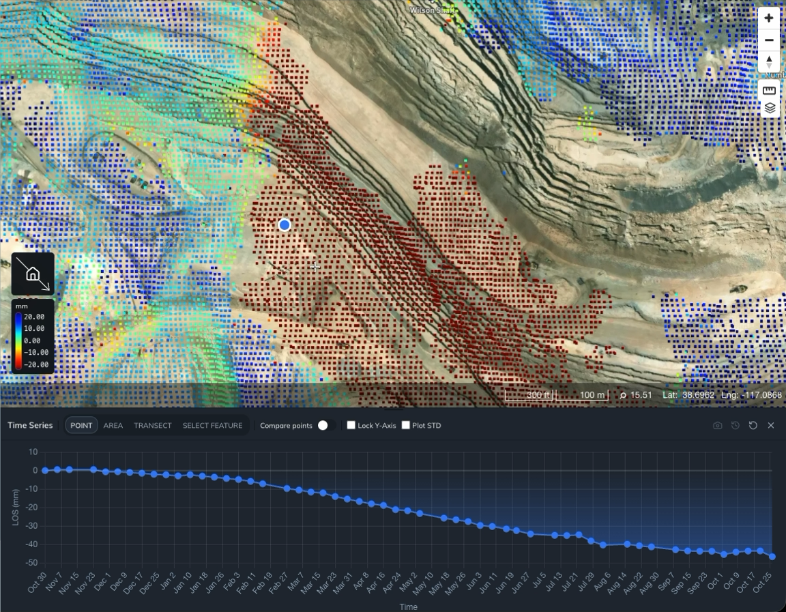
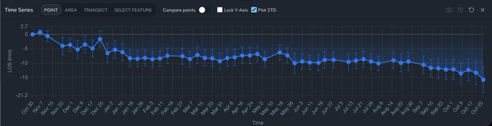

# Inspect and compare point deformation

Select a location on the map to view its deformation over time. To compare locations, add up to three points to the same time series chart.

## View a point time series

1. [Open a site and analysis](select-site.md) and wait for the data to load.
2. In the **Time Series** toolbar beneath the map, click **POINT**.
3. Click a location on the map where deformation data is available.

Iris places a marker at the selected location and displays its time series beneath the map. The chart shows time along the horizontal axis and deformation along the vertical axis. Check the vertical axis label for the measurement and units; the example below shows **LOS (mm)**.

## Move the selected point

With **Compare points** switched off, click another location on the map to move the point, or drag its marker to a new location. The chart updates to show the time series for the new location.

Use this to explore how deformation varies across the site.

To mark locations you want to revisit, [create a Measurement Sites vector layer](vector-layers.md#create-measurement-site-points).

## Show measurement uncertainty

Select **Plot STD** in the **Time Series** toolbar to display standard deviation as error bars on the deformation measurements. Clear the checkbox to hide them.

Compare the size of the deformation with the error bars to assess the movement relative to its measurement uncertainty.

## Compare up to three points

1. Select your first point using **POINT** mode.
2. Switch on **Compare points** in the **Time Series** toolbar.
3. Click another location on the map to add a second point.
4. Click a third location if you want to compare three points.

Iris displays the points together on the chart. Match each series to its map marker using the colors and the **Point 1**, **Point 2**, and **Point 3** labels.

The limit is **three points in total**. To remove a point, click **×** beside its name in the toolbar. You can then click the map to add another location.

To examine deformation along a line, [view a transect profile](transect-profiles.md).

To summarize deformation across a region, [view an area time series](area-time-series.md) or [inspect an anomaly polygon](deformation-anomalies.md).

To download the displayed measurements, [export the current plot as CSV](export-data.md#export-the-current-plot).

--8<-- "snippets/contact-footer.md"
