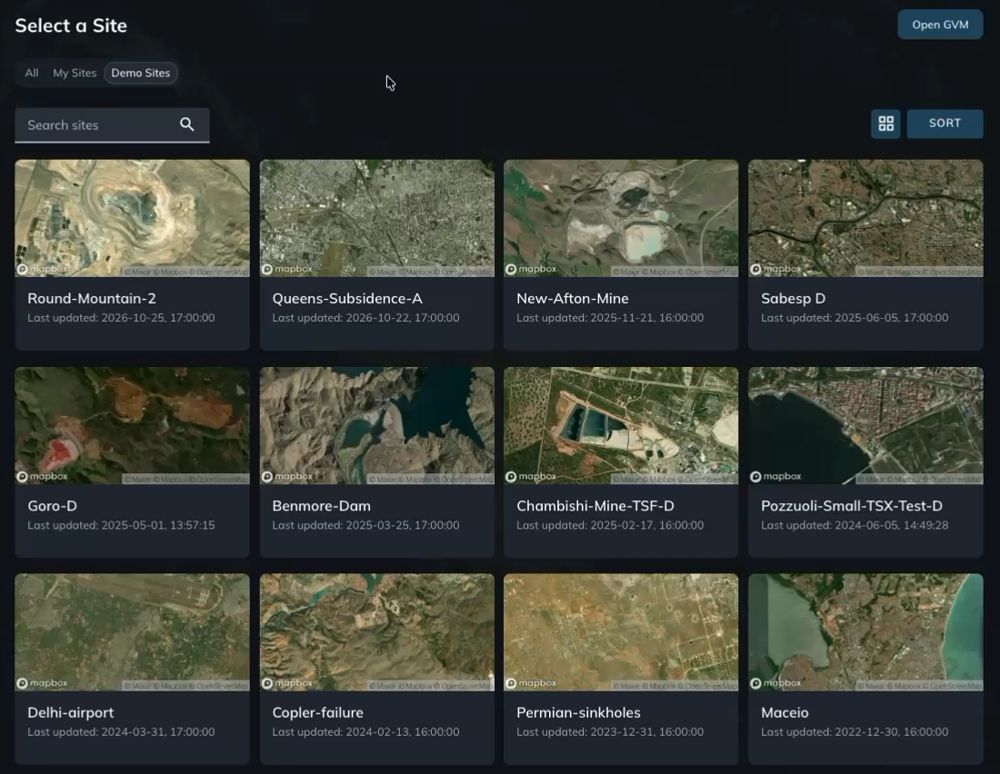
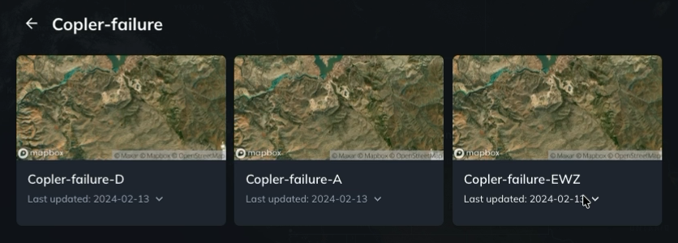
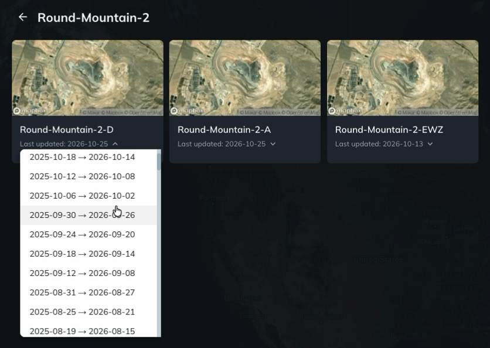

# Select a site and analysis

Start in Iris 2.0 by choosing a site and the analysis you want to explore. You can browse demo sites or your own sites, then open the latest analysis or select an earlier analysis period.

## Find a site

1. On the **Select a Site** screen, choose **Demo Sites** to explore sample sites, or **My Sites** to browse your own sites.
2. Browse the site cards, or enter a site name in **Search sites**.
3. Click a site to see its available analyses.

## Choose an analysis type

A site can have analyses from ascending observations, descending observations, or a combination of both. The suffix in each analysis name identifies its type.

| Suffix | Analysis type | Description |
| --- | --- | --- |
| **D** | Descending | Uses satellite observations from descending passes. |
| **A** | Ascending | Uses satellite observations from ascending passes. |
| **EWZ** | East–west and vertical | Combines ascending and descending observations using their viewing geometry to calculate east–west and vertical deformation components. |

For example, **Copler-failure-D**, **Copler-failure-A**, and **Copler-failure-EWZ** are different analysis types for the same site.

Once an analysis opens, its [map legend](analysis-legends.md) identifies the viewing geometry or deformation component being displayed.

## Choose an analysis period

Iris selects the most recent analysis by default. Click the analysis card to open it.

To open a different analysis when multiple periods are available:

1. Click the dropdown arrow beside **Last updated** on the analysis card.
2. Select the analysis period you want to open. Each option shows its start and end dates.

Analyses typically cover a one-year window. This captures longer-term deformation trends and provides enough observations to support measurements with high confidence.

Once the analysis opens, [change the map appearance](map-display.md) to choose a basemap and adjust the data opacity and colors.

--8<-- "snippets/contact-footer.md"
