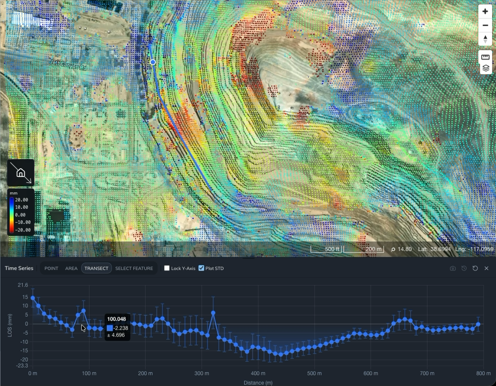
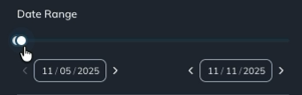
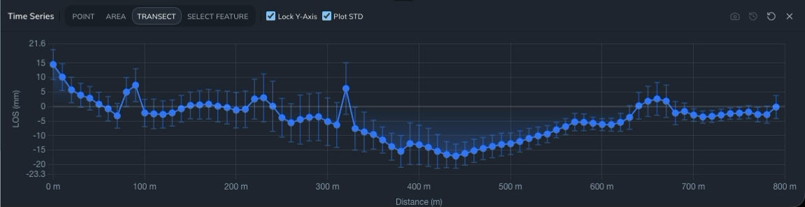

# View deformation along a transect

Draw a line across the site to view a deformation profile. Step through the analysis dates to see how deformation develops along the same line over time.

## Draw a transect

1. [Open a site and analysis](select-site.md) and wait for the data to load.
2. In the **Time Series** toolbar beneath the map, click **TRANSECT**.
3. Draw a line on the map along the area you want to investigate.
4. Wait for the profile to load beneath the map.

The chart now shows **distance along the transect in meters** on the horizontal axis and **deformation** on the vertical axis. Check the vertical axis label for the measurement and units; the example below shows **LOS (mm)**.

The profile displays deformation for the **end date** selected under **Date Range**. A point time series plots one location through time; a transect profile plots locations along a line at the selected end date.

Select **Plot STD** to show standard deviation as error bars along the profile. Use these to assess deformation relative to its measurement uncertainty.

## Follow the profile through time

Keep the transect in place and change the end date to examine how deformation develops along it.

1. With the full analysis period selected, select **Lock Y-Axis** in the **Time Series** toolbar. This keeps the chart's current vertical limits fixed.
2. In the **Analysis** panel, find **Date Range**. Keep the start date fixed and drag the right-hand slider handle back to the earliest available end date, or epoch 0.
3. Use the right arrow beside the end-date field to advance through the available dates. You can also drag the end-date handle forward to move through the period.
4. Allow the map and profile to finish updating at each date before comparing the next one.

At each step, the map and distance profile update for the selected end date. With the y-axis locked, you can compare deformation magnitudes on a consistent vertical scale throughout the analysis window.

Clear **Lock Y-Axis** when you want the chart to scale automatically again.

--8<-- "snippets/contact-footer.md"
