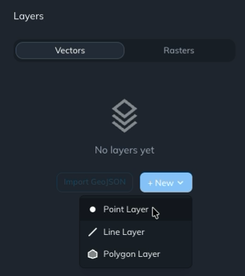
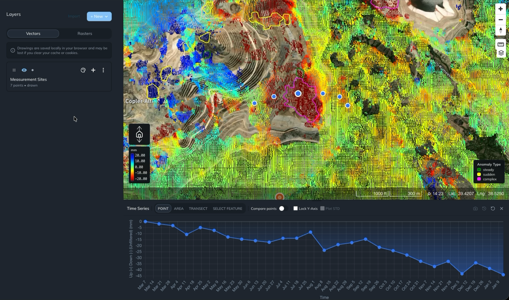
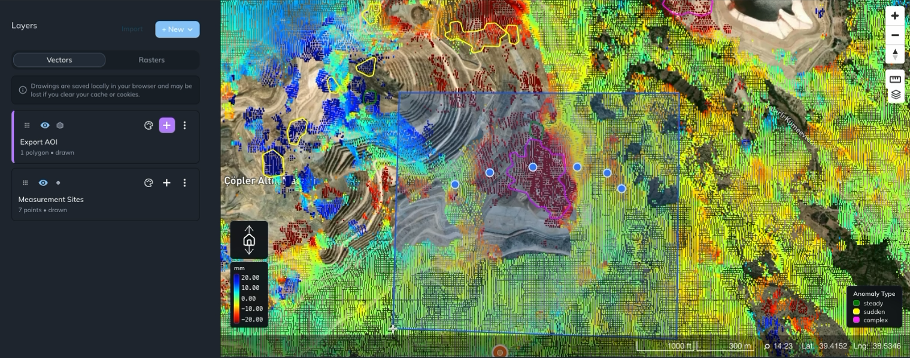

# Draw and import vector layers

Use vector layers to mark measurement locations and define areas on the map. You can draw points, lines, and polygons, or import features from a GeoJSON file.

## Open vector layers

1. [Open a site and analysis](select-site.md).
2. Click the **stacked layers icon in the left toolbar** to open **Layers**.
3. Select the **Vectors** tab.

Drawings are stored locally in your browser and may be lost if you clear its cache or cookies.

## Create measurement site points

A named point layer helps you return to the same measurement locations when reviewing deformation at different times.

1. Click **+ New** and choose **Point Layer**.
2. Rename the layer **Measurement Sites**, or give it another descriptive name.
3. Click **+** on the layer card to add features.
4. Click each location on the map where you want a measurement point.
5. Click **+** again to leave drawing mode.

The layer card shows the number of points you have added.

To inspect a measurement location, select **POINT** in the **Time Series** toolbar and click its location on the map. Iris displays the deformation time series for that location. Use the same marked locations when returning to your measurements. See [Inspect and compare point deformation](point-time-series.md) for point chart controls.

## Import GeoJSON features

Use **Import GeoJSON** in an empty vector panel, or **Import** at the top of the **Layers** panel, to load a `.geojson` file. Select the file containing the features you want to add.

Importing existing features lets you use predefined measurement locations or boundaries alongside your deformation analysis.

## Draw an export AOI

Create a polygon to define an **area of interest (AOI)** for an export.

1. In **Layers → Vectors**, click **+ New** and choose **Polygon Layer**.
2. Rename the layer **Export AOI**.
3. Click **+** on its layer card to enter drawing mode.
4. Draw and complete a polygon around the area you want to export.
5. Leave drawing mode when you have finished.

The polygon appears on the map, and its layer card shows the polygon count. Choose this layer in the Export panel to [export analysis data within the AOI](export-data.md#export-a-polygon-aoi).

You can also [select an existing polygon](area-time-series.md#select-an-existing-polygon) to view the average deformation within its boundary.

--8<-- "snippets/contact-footer.md"
