# Subscription Manager

## Introduction

[**Subscription Manager**](https://console.earthdaily.com/subscription-manager) is where you manage your EarthDaily Constellation (EDC) subscriptions. From one place you can:

- See every subscription on your account, its area, its dates, and how much quota is left
- Track the imagery delivered to each subscription, day by day
- Choose scenes and place orders on Pull subscriptions
- Download delivered products

Subscription Manager is enabled for your organization when EarthDaily sets up your account, so there's nothing to request. If you can't see it, contact [support@earthdaily.com](mailto:support@earthdaily.com).

## Push and Pull subscriptions

Every subscription is either **Push** or **Pull**. Both cover a fixed geographic area, the **subscription area**, for a fixed period. The difference is how imagery reaches you.

| | Push | Pull |
|---|---|---|
| In short | Every eligible pixel in the subscription area, every day | On-demand download, within the subscription area |
| How imagery arrives | Delivered automatically as it's captured | You choose the scenes you want and place an order |
| Download quota | Not used | An annual download quota, in km² |
| Ordering in Subscription Manager | Not needed | Available while the subscription is active |

A few terms used throughout this page:

- **Subscription area**: the area your subscription covers. Maps in Subscription Manager outline it in yellow. Pull orders must fall entirely inside it.
- **Available quota**: on a Pull subscription, the area (km²) you can still order. Each order deducts its estimated area. Scenes that fail to process are refunded to your quota automatically.
- **Active**: today falls between the subscription's start and end dates. Pull orders can only be placed on active subscriptions.

For the products each subscription can deliver, see the [EDC Product Specification](../../../data/edc-product-specification.md).

## Getting started

Open [Subscription Manager](https://console.earthdaily.com/subscription-manager) to land on the **Subscriptions** page. The left-hand navigation has two pages: **Subscriptions** and **Account**.

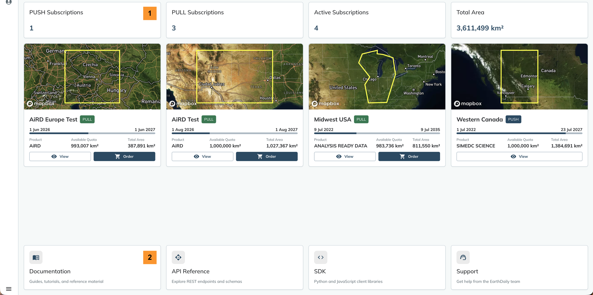

| S. No | Label | Description |
|-------|-------|-------------|
|  | Summary | Counts of your **PUSH Subscriptions**, **PULL Subscriptions** and **Active Subscriptions**, plus the **Total Area** they cover |
|  | Resources | Links to this documentation, the API reference, the Python SDK, and support |

Each subscription appears as a card:

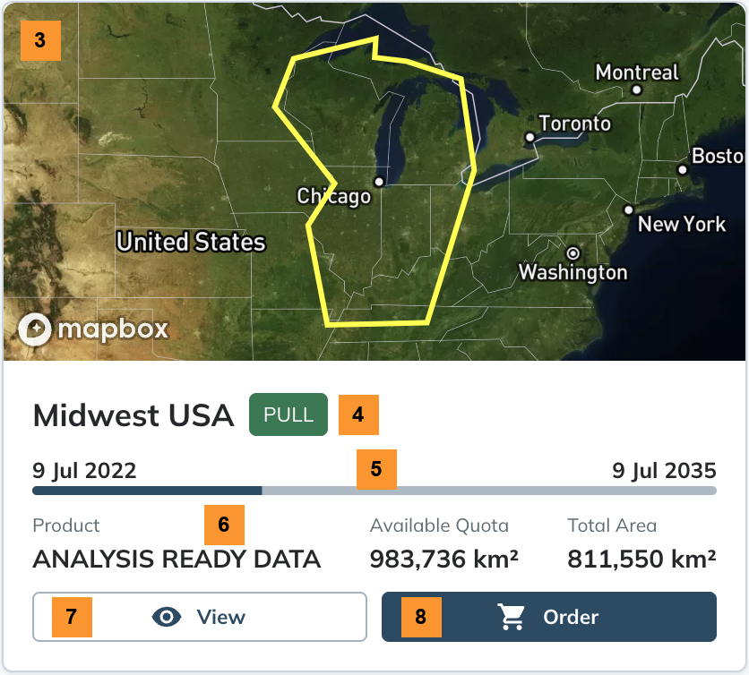

| S. No | Label | Description |
|-------|-------|-------------|
| 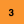 | Map | The subscription area, outlined in yellow |
| 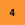 | Name and type | The subscription name and a **PUSH** or **PULL** badge |
| 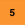 | Dates | Start and end dates. The bar shows how far through the subscription period you are, and turns red when the subscription isn't active. |
| 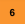 | Details | The **Product**, **Available Quota** ("No Quota" when none remains) and **Total Area** of the subscription |
|  | View | Opens the subscription's page |
| 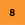 | Order | Starts a new order. Only shown on active Pull subscriptions. |

## Viewing a subscription

Select **View** on a card to open the subscription's page. Use **Back to Subscriptions** to return.

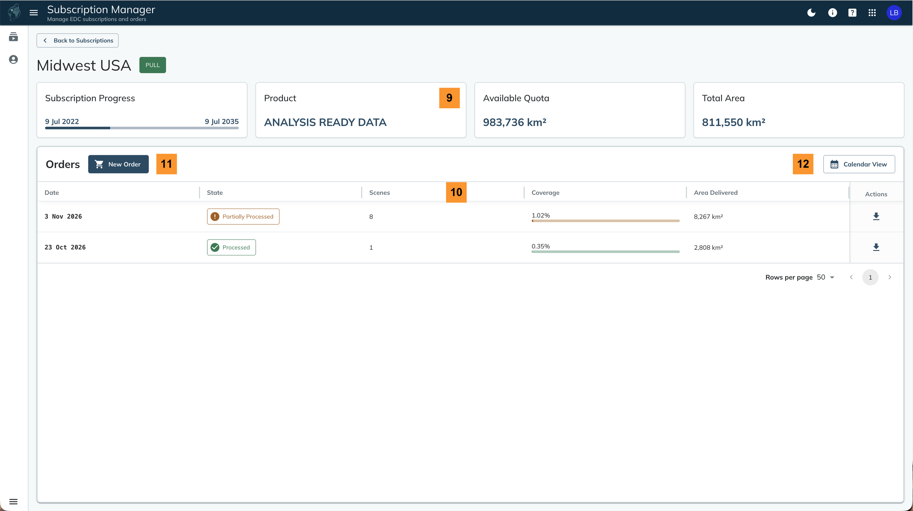

| S. No | Label | Description |
|-------|-------|-------------|
| 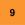 | Summary | **Subscription Progress** (start and end dates), **Product**, **Available Quota** and **Total Area** |
| 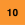 | Orders | One row per day, with its **State**, number of **Scenes**, **Coverage** of the subscription area, and **Area Delivered**. Use the download button on a row to download that day's products. |
| 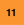 | New Order | Starts a new order. Only shown on active Pull subscriptions. |
| 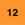 | Calendar View | Switches to a monthly calendar. Days with deliveries show their coverage, number of scenes, and a dot coloured by state. Select **Table View** to switch back. |

Each row in **Orders** groups everything for one day:

- On a **Push** subscription, a row holds the scenes captured that day.
- On a **Pull** subscription, a row holds the scenes you ordered that day. If you check out more than once in a day, those orders share a row.

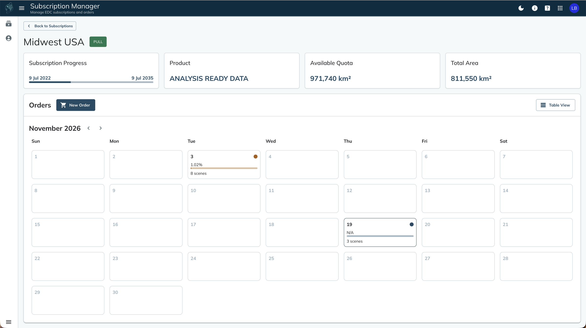

### Order details

Select a row, or a day in the calendar, to open its details beside the table:

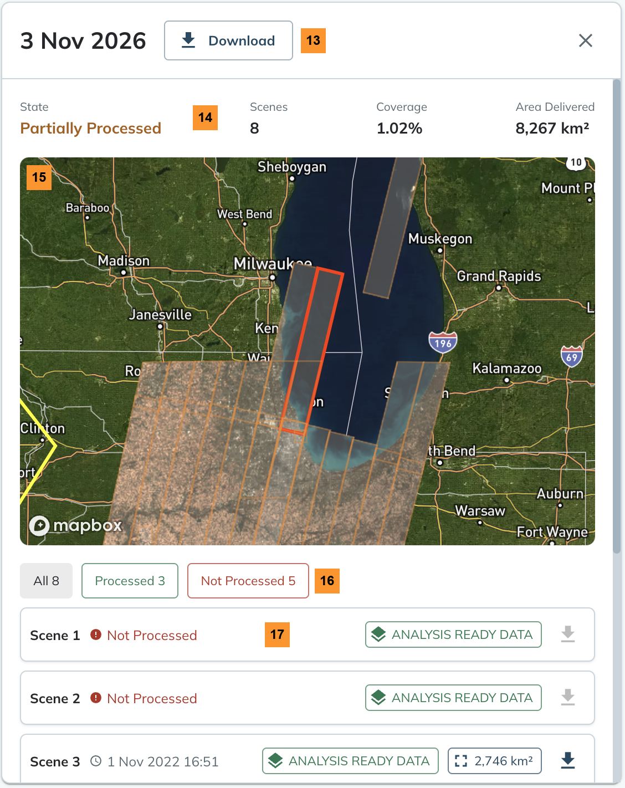

| S. No | Label | Description |
|-------|-------|-------------|
| 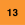 | Download | Downloads every product for that day. Unavailable while scenes are still processing. See [Downloading data](#downloading-data). |
| 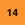 | Summary | The day's **State**, number of **Scenes**, **Coverage** of the subscription area, and **Area Delivered** |
| 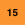 | Map | Delivered imagery and scene outlines. The scene you select in the list is highlighted in red. |
| 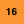 | Filters | Show **All** scenes, or only those that are **Processed**, **Not Processed** or **Processing**. Each filter shows how many scenes it holds. |
| 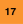 | Scenes | Select a scene to zoom the map to it, or use its download button to download only that scene. Scenes are listed 50 to a page. |

### Order and scene states

The **State** of a day summarizes its scenes:

| State | Meaning |
|-------|---------|
| Processing | At least one scene is still being processed |
| Processed | Every scene was delivered |
| Partially Processed | Some scenes were delivered and some failed |
| Failed | No scenes were delivered |

Each scene in the list shows one of:

| Scene status | Meaning |
|--------------|---------|
| Date and time | Processed. The date and time are when the scene was captured. |
| Processing... | Still being processed |
| Not Processed | Processing failed or was cancelled. On Pull subscriptions, the scene's area is refunded to your quota. |

## Placing a Pull order

You can place orders on **Pull** subscriptions that are **active**. Select **Order** on the subscription card, or **New Order** on the subscription page.

The order page has three steps on the left and a map on the right. The map opens on the most recent imagery in your subscription area.

### Step 1: Area of Interest

Choose the area you want imagery for:

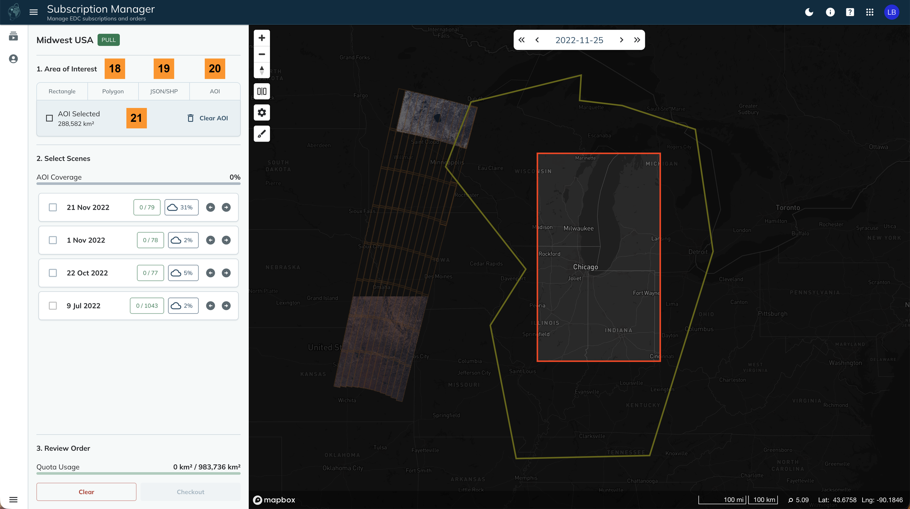

| S. No | Label | Description |
|-------|-------|-------------|
| 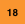 | Draw | Draw a **Rectangle** or **Polygon** on the map |
| 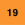 | JSON/SHP | Opens the **GeoJSON Viewer**, where you can paste GeoJSON or upload a file instead of drawing |
| 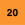 | AOI | Use your whole subscription area |
| 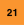 | AOI Selected | Shows the size of your area. **Clear AOI** removes it so you can start again. |

In the **GeoJSON Viewer**, paste GeoJSON into the editor, or drag and drop a file onto the area below it, then select **Apply**.

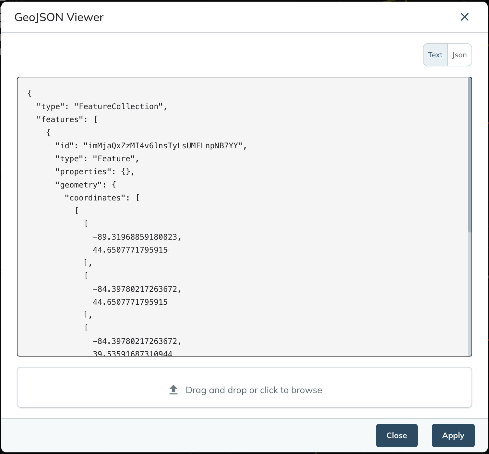

Your area of interest must:

- Sit entirely inside the subscription area. If it doesn't, you'll see "AOI must be within the Subscription Area" and the area isn't applied.
- Be at least 25 km², with every side longer than 5 km
- Lie between latitudes 85°S and 85°N, and not cross the antimeridian (180° longitude)
- Be a single shape without holes, with no more than 1,000 points

Changing your area of interest clears any scenes you've already selected.

### Step 2: Select Scenes

Once your area of interest is set, the dates with imagery over it are listed, newest first:

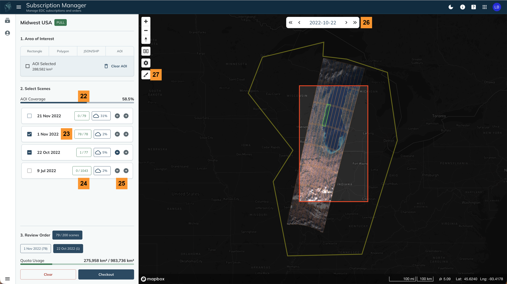

| S. No | Label | Description |
|-------|-------|-------------|
| 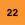 | AOI Coverage | How much of your area of interest the selected scenes cover |
| 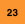 | Select date | Selects every scene from that date. Unavailable for dates with more than 200 scenes, so select those scenes on the map instead. |
| 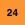 | Scenes and cloud cover | How many of the date's scenes are selected, and their average cloud cover |
| 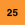 | Visualize | Shows that date on the left-hand map, or on a right-hand map side by side for comparison |
| 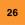 | Map date | The date shown on the map. Use the arrows to step through dates within the subscription period. |
| 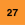 | Paint brush | Turn it on, then drag across the map to select many scenes at once |

You can also click a scene's outline on the map to add it to your order or remove it. Selected scenes are shaded green. If you're zoomed too far out to see imagery, the map asks you to zoom in.

Select **Load More** at the bottom of the list to see older dates.

To compare two dates, select the right arrow on a date. The map splits in two, with its own date controls on each side. Drag the divider to compare the dates.

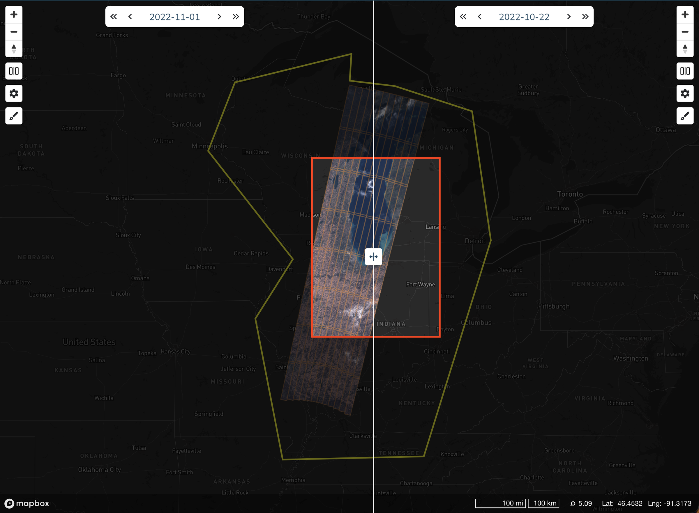

### Step 3: Review Order

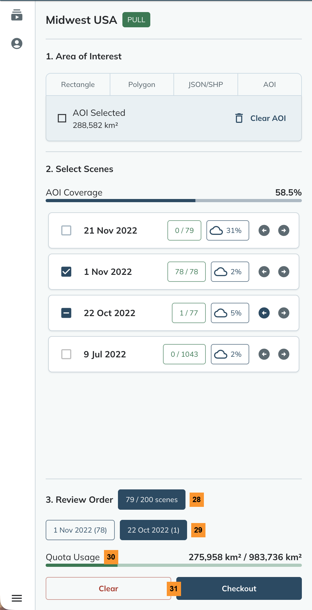

| S. No | Label | Description |
|-------|-------|-------------|
| 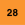 | Scene count | Number of scenes in the order. An order can include up to 200 scenes. |
| 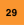 | Dates | Each date in the order with its number of scenes. Select one to show it on the map. |
| 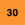 | Quota Usage | The order's estimated area against your available quota. Turns red if the order needs more quota than you have. |
| 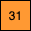 | Clear and Checkout | **Clear** removes your area of interest and every selected scene. **Checkout** submits the order. |

**Checkout** is unavailable until you've selected at least one scene. It stays unavailable if the order needs more quota than you have, or includes more than 200 scenes.

!!! warning
    Pull orders can't be cancelled once submitted. The order's estimated area is deducted from your quota at checkout. Scenes that fail to process are refunded to your quota automatically.

### Confirmation

When your order is submitted, a confirmation shows its name and submission time:

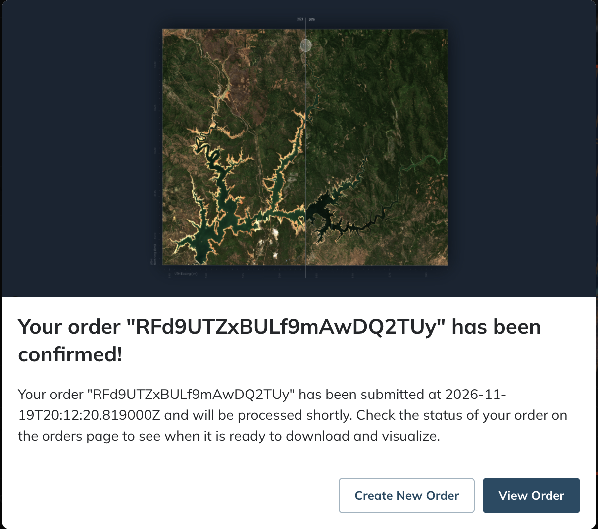

- **View Order** returns to the subscription page, where the order appears under today's date in **Orders**.
- **Create New Order** clears the form so you can place another order.

## Downloading data

You can download delivered products in three ways:

- **A whole day:** use the download button on a row in **Orders**, or **Download** in the order details.
- **A single scene:** use the download button next to the scene in the order details.
- **Large days:** if a day has more than 20 scenes, the download button opens the [Downloading Assets](../api/api-usage/endpoints.md#downloading-assets) guide instead, because larger downloads are best done through the API.

Downloads in progress appear in a panel at the bottom right of the page.

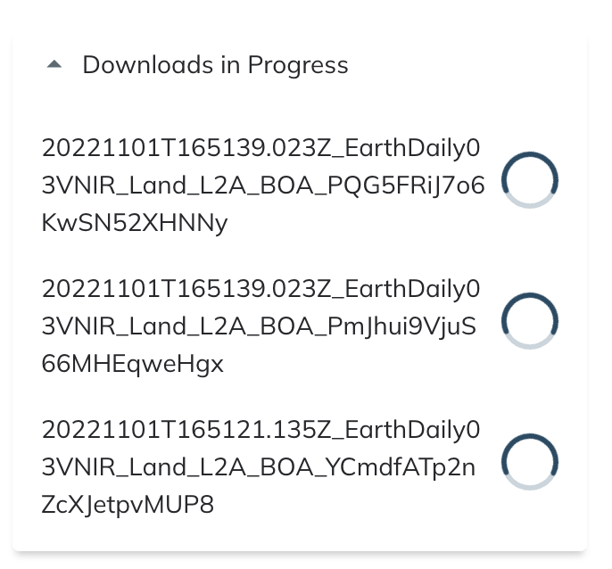

## Account

The **Account** page shows your organization and your API access.

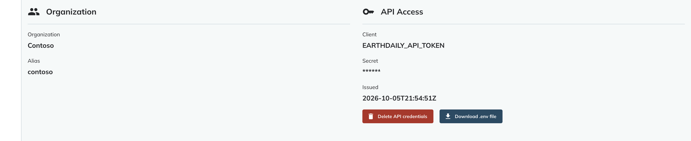

- **Organization**: your organization's name and alias.
- **API Access**: your API credentials, for downloading through the API or the [Python SDK](https://github.com/earthdaily/earthdaily-python-client). The secret is masked.
    - **Download .env file** saves your credentials as a `.env` file, ready to use with the SDK.
    - **Delete API credentials** revokes them. Anything using them stops working.

See [API Authentication](../getting-started/authentication.md) for how to use your credentials.

## Limits

| Limit | Value |
|-------|-------|
| Pull order area of interest | Inside the subscription area, at least 25 km², every side over 5 km, no holes, up to 1,000 points |
| Scenes per order | 200 |
| Scenes per date selectable at once | 200 |
| Scenes per day downloadable in Subscription Manager | 20 (use the API for more) |
| Dates you can order | From the subscription start date to today |
